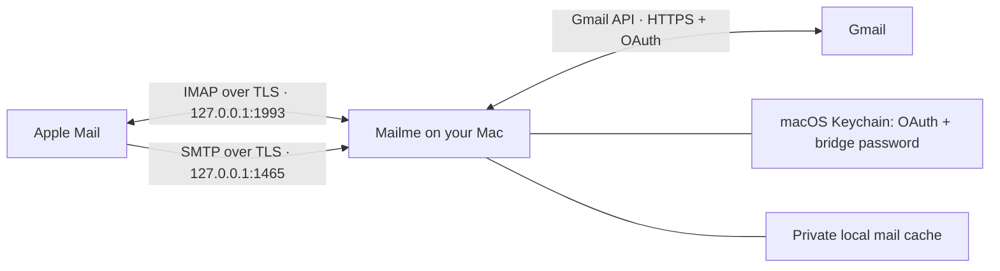

# Mailme

A local Gmail API bridge for Apple Mail, written in Go. Apple Mail talks IMAP and SMTP **only to your Mac**. Mailme talks to Google using OAuth and the Gmail REST API over HTTPS. It never connects to Google's IMAP or SMTP servers.

This is an initial, tested implementation for one account. Protocol integration tests use a fake Gmail service; a live Workspace account and Apple Mail have **not** yet been tested together.



SMTP handles sending; IMAP is also needed to read mail, discover folders, and synchronize changes. The organization must permit the local bridge and authorize its OAuth app. This does not override Google Workspace API access controls.

## What works

- Desktop OAuth with PKCE, state validation, and an ephemeral loopback callback. Tokens and a random local bridge password are stored in macOS Keychain.
- Authenticated IMAP and SMTP over TLS, bound to numeric loopback addresses only. A unique localhost certificate is generated at login.
- Inbox, Sent, All Mail, Trash, Junk, Starred, and custom Gmail labels. User labels appear beneath `Labels/`.
- MIME message bodies, attachments, partial IMAP fetches, envelope/body structure, and searches including decoded text.
- Read/unread and starred flags synchronized to Gmail. Replied and pending-deletion flags are kept locally.
- Persistent per-folder UIDs and UIDVALIDITY, updates across simultaneous connections, and IMAP IDLE notifications after polling Gmail.
- Full metadata sync on first run, then history-based sync every 30 seconds. Expired Gmail history triggers a full reconciliation. Failed syncs do not advance the saved cursor.
- SMTP envelope recipients mapped to Gmail's header-based recipient model, including Bcc. MIME bodies are preserved.

## Set up Google access

Use your organization's approved Google Cloud project and OAuth client:

1. Enable the Gmail API in the project.
2. Configure the Google Auth Platform consent screen/audience as appropriate for your Workspace organization.
3. Create an OAuth client of type **Desktop app** and download its JSON credentials. Web-client credentials are rejected.
4. Request `https://www.googleapis.com/auth/gmail.modify`. It covers reading, sending, labels, and moving messages to Trash, without permanent message deletion. It is a restricted scope, so Workspace administrators may need to approve this client ID. See [Google's scope reference](https://developers.google.com/workspace/gmail/api/auth/scopes) and [Workspace app access controls](https://support.google.com/a/answer/7281227).

Keep the downloaded credentials outside the repository. Desktop OAuth uses a loopback redirect supported by [Google's native app flow](https://developers.google.com/identity/protocols/oauth2/native-app).

## Build and connect

Requires macOS, Go 1.24 or later, and access to your login Keychain.

```sh
go build -o bin/mailme ./cmd/mailme
./bin/mailme login --credentials /absolute/path/client.json --email you@company.com
./bin/mailme settings
./bin/mailme serve
```

The login command opens Google's consent page and checks that the authorized account matches `--email`. It does not send email. `settings` deliberately prints the **local bridge password** for entering into Apple Mail; do not share that output. Your Google password is never given to the bridge or Apple Mail.

The default data directory on macOS is `~/Library/Application Support/mailme`. To change it, pass the same `--data-dir /absolute/path` to every command. Custom ports are configured with `serve --imap 127.0.0.1:1993 --smtp 127.0.0.1:1465`; pass those flags to `settings` as well to display them. Only one process may open a data directory.

Keep `serve` running while using Mail. The first metadata sync completes before the service starts accepting connections, and can take a while for a large mailbox. Message bodies are downloaded and cached on demand; Apple Mail may fetch many of them immediately.

## Configure Apple Mail

First trust the generated `localhost.crt` from the data directory using **Keychain Access**: import it into your login keychain, open the certificate, and explicitly trust it for SSL. This certificate is used only for the local connection. Mailme does not install trust settings automatically. Do not import or share `localhost.key`.

Add **Other Mail Account**, using the work email and the local bridge password. Select **IMAP**. Use these server settings:

| Setting | Incoming | Outgoing |
| --- | --- | --- |
| Host | `127.0.0.1` | `127.0.0.1` |
| Port | `1993` | `1465` |
| TLS/SSL | Enabled, implicit TLS | Enabled, implicit TLS |
| Authentication | Password | Password |
| Username | Full work email | Full work email |
| Password | Local bridge password | Local bridge password |

Disable **Automatically manage connection settings** so Mail uses these ports. The initial account wizard may fail while trying standard ports; finish manual configuration in Mail's account settings. Exact screens differ by macOS version. Refer to [Apple's server settings guide](https://support.apple.com/guide/mail/change-server-settings-cpmlprefacctadv/mac).

In **Mail → Settings → Accounts → Mailbox Behaviors**, configure:

| Mailbox behavior | Selection |
| --- | --- |
| Drafts | An **On My Mac** mailbox |
| Sent | An **On My Mac** mailbox |
| Trash | `Gmail/Trash` |
| Junk | `Gmail/Junk` |
| Archive | `Gmail/All Mail` |
| Erase deleted messages | **Never**; empty Trash through Gmail |

Local Drafts and Sent are required because IMAP APPEND is not implemented. Gmail already saves messages submitted via the API in its Sent mailbox, which appears as `Gmail/Sent`. Mail's local Sent copy is separate and may also appear in its unified Sent view. Drafts remain on this Mac. Apple documents these mailbox choices in [Mailbox Behaviors](https://support.apple.com/guide/mail/change-mailbox-behaviors-settings-cpmlprefacctmbox/mac).

## Message operations

| Action | Gmail result |
| --- | --- |
| Read / unread | Remove / add `UNREAD` |
| Star / unstar | Add / remove `STARRED` |
| Copy into a user-label folder | Add that label to the same Gmail message |
| Move from Inbox to a user-label folder | Add destination label, then remove `INBOX` |
| Archive from Inbox | Remove `INBOX` |
| Move to Trash | Gmail `messages.trash` |
| Move from Trash to Inbox | Untrash, then add `INBOX` |
| Expunge a deleted message from Inbox or a user-label folder | Remove that source label |
| Expunge from Starred | Remove `STARRED` |
| Expunge from All Mail, Sent, or Junk | Move to Trash |
| Expunge from Trash | Rejected; no permanent deletion endpoint exists in this bridge |

Gmail labels are views of the same message, so an IMAP copy does not duplicate the underlying message. `\Deleted` is staged per folder and persisted until expunge; it is not immediately a Gmail deletion. Cross-folder moves use the client's COPY + STORE + EXPUNGE sequence. There is no IMAP MOVE extension yet.

## Storage and operational details

- `config.json`: account and OAuth client configuration, mode `0600`.
- `mail.db`: bbolt database with metadata, persistent UIDs, local flags, subscriptions, and downloaded MIME bodies, mode `0600`.
- `localhost.crt` / `localhost.key`: local TLS identity, valid for one year. To renew, stop the bridge, move both files aside, rerun login, and trust the new certificate.
- Keychain service `mailme.gmail-api-bridge`: `<email>:oauth` and `<email>:bridge` entries.

The cache is **not encrypted by the application**. Protect it using the Mac's normal disk encryption and access controls, and treat backups as mail data. The program does not log message bodies, passwords, or OAuth tokens. Raw protocol tracing is disabled. Deleting the cache changes IMAP identities and causes Mail to resynchronize; stop the bridge before manipulating it.

Gmail requests are paced. Read-only requests retry transient server/rate-limit errors with backoff. Writes are not automatically retried. If a send fails after Google may have accepted it, Mail receives an error asking you to check Gmail Sent before retrying. Exactly-once delivery cannot be guaranteed across an interrupted API response or a disconnected local SMTP client.

If Google blocks authorization, use the organization's app approval process. If refresh authorization expires or is revoked, rerun `login`. External apps left in Google's Testing state can have short-lived refresh tokens; see [Google's token expiration rules](https://developers.google.com/identity/protocols/oauth2#expiration).

## Current limits

- One account per process/data directory. Sending aliases, delegation, contacts, and calendars are not implemented.
- Draft synchronization, IMAP APPEND/import, folder creation/rename/deletion, permanent deletion, custom keywords, QRESYNC/CONDSTORE, and UIDPLUS are not implemented. Manage labels in Gmail.
- No offline write queue. Existing cached bodies remain readable during a subsequent sync failure, but startup requires a successful sync.
- A simple in-memory metadata index is persisted transactionally. Operations and sync are serialized to preserve ordering, so a long initial sync or text search can delay other IMAP commands. This has not been load-tested against a very large mailbox.
- Gmail changes appear on the polling interval, plus API processing time. No Cloud Pub/Sub setup is required.
- The IMAP dependency is pinned to a v2 beta. Automated protocol coverage does not establish full Apple Mail compatibility; finish the manual checklist below before relying on this for daily work.

## Validation

```sh
go test -race ./...
go vet ./...
go build -o bin/mailme ./cmd/mailme
```

Tests use synthetic messages and temporary local TLS/HTTP listeners. They do not access Keychain secrets, authenticate to Google, or send real email. They cover OAuth state/PKCE, TLS identity and loopback restrictions, Gmail pagination/retries, sync recovery, UID persistence, MIME/attachments, decoded search, deletion semantics, concurrent IMAP views, IDLE, SMTP authentication, and Bcc preservation.

For the first live setup, verify:

1. Inbox and existing custom labels appear; an attachment opens correctly.
2. Read/unread and stars reflect in both Gmail and Mail.
3. New mail appears while Mail is idle, and restart does not duplicate messages.
4. Archive and Trash behave as expected, and moving a message out of Trash restores it.
5. A deliberate test email to yourself, with a second address in Bcc, arrives correctly. Confirm one server-side Sent copy and correct reply threading.
6. Drafts save locally, and Mail does not try to APPEND to the bridge's Sent folder.

For background use, `contrib/com.mailme.bridge.plist.example` is a launchd template. Replace its absolute-path placeholders and install it as a per-user LaunchAgent after live validation; run it as your logged-in user so it can access your login Keychain.

The API synchronization and send semantics follow [Google's synchronization guide](https://developers.google.com/workspace/gmail/api/guides/sync) and [messages.send reference](https://developers.google.com/workspace/gmail/api/reference/rest/v1/users.messages/send).

## License

MIT. Copyright (c) 2026 Aditya Walvekar. See [LICENSE](LICENSE).
