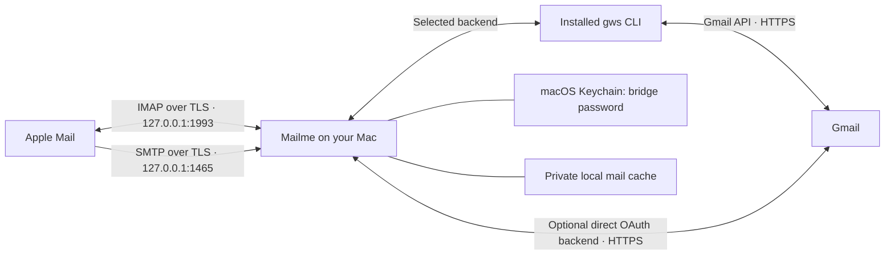

# Mailme

A local Gmail API bridge for Apple Mail, written in Go. Apple Mail talks IMAP and SMTP **only to your Mac**. Mailme talks to Google through the installed Google Workspace CLI (`gws`), or directly with Desktop OAuth, using the Gmail REST API over HTTPS. It never connects to Google's IMAP or SMTP servers.

This is an implementation for one account. The first live Workspace run exposed slow backfill, lost progress, and an intermittent HTTP 400. The recovery and concurrency changes below have been tested with a simulated CLI and fake Gmail service, including process-kill recovery. They have **not yet been validated on that live mailbox**.



SMTP handles sending; IMAP is also needed to read mail, discover folders, and synchronize changes. The organization must permit the local bridge and authorize its OAuth app. This does not override Google Workspace API access controls.

## Download a release

[GitHub Releases](https://github.com/adwalvekar/mailme/releases) provide an Apple Silicon macOS package, `mailme_<tag>_darwin_arm64.tar.gz`, and `SHA256SUMS`. Download both from the same release, verify the checksum, and extract the archive. For example, for `v0.1.0`:

```sh
shasum -a 256 -c SHA256SUMS
tar -xzf mailme_v0.1.0_darwin_arm64.tar.gz
./mailme_v0.1.0_darwin_arm64/mailme version
```

The archive contains the executable, license, README, manual LaunchAgent example, and `BUILD.json` with its version, commit, build date, Go version, and platform. Release packages target **Apple Silicon only**. Developer ID signing and Apple notarization are not configured.

Move the executable to a stable location before starting the background service, since the LaunchAgent saves that exact path. For an existing installation, stop the service before replacing the binary, then run the new binary's `install-agent` with the runtime settings you want to retain. Login, Gmail/gws access, and local certificate trust still follow the setup below; a downloaded binary removes the need to install Go.

## What works

- An installed, authenticated `gws` CLI can provide all Gmail access using its existing credentials and token refresh. No additional OAuth app is needed in this mode. The local bridge password is stored separately in macOS Keychain.
- Optional direct Desktop OAuth with PKCE, state validation, and an ephemeral loopback callback; this backend also stores its Google tokens in macOS Keychain.
- Authenticated IMAP and SMTP over TLS, bound to numeric loopback addresses only. A unique localhost certificate is generated at login.
- Inbox, Sent, All Mail, Trash, Junk, Starred, and custom Gmail labels. User labels appear beneath `Labels/`.
- MIME message bodies, attachments, partial IMAP fetches, envelope/body structure, and searches including decoded text.
- Read/unread and starred flags synchronized to Gmail. Replied and pending-deletion flags are kept locally.
- Persistent per-folder UIDs and UIDVALIDITY, updates across simultaneous connections, and IMAP IDLE notifications after polling Gmail.
- Immediate TLS/IMAP/SMTP service using cached or partial mail. A fresh Inbox can initially be empty; new messages appear through EXISTS/IDLE as backfill commits.
- INBOX-first metadata backfill with six readers by default, durable batch checkpoints, and resume after a process crash. History-based sync follows every five seconds by default, configurable down to one second. Failed attempts keep completed batches without advancing the history cursor.
- Shared body downloads for simultaneous requests for the same message, cached envelope headers, and header searches that avoid downloading bodies when possible.
- SMTP envelope recipients mapped to Gmail's header-based recipient model, including Bcc. MIME bodies are preserved.

## Build and connect with gws

Requires macOS, Go 1.24 or later, access to your login Keychain, and an installed [Google Workspace CLI](https://github.com/googleworkspace/cli). This setup assumes `gws` is already authenticated for your work account using your organization's approved app.

```sh
go build -o bin/mailme ./cmd/mailme
./bin/mailme login --backend gws --email you@company.com
./bin/mailme settings --copy-password
./bin/mailme serve
```

On macOS, `serve` installs/starts a per-user background service and returns to the terminal. It starts again at login and launchd restarts it after a crash. Use `serve --foreground` for an interactive session or under a different service manager.

`login --backend gws` checks your Gmail profile through the CLI, saves the selected backend and absolute executable path, and creates the local bridge password and TLS identity. It does not install `gws`, open an OAuth consent page, export CLI tokens, or send email. To select a particular installation, add `--gws-path /absolute/path/to/gws` to `login`. An npm `@googleworkspace/cli` Node shim is resolved to its installed native `bin/gws`, so launchd does not need nvm's `node` on PATH. An unresolved Node shim produces an actionable error. `serve` uses the saved backend; it does not fall back to direct OAuth.

The CLI's existing authorization needs `https://www.googleapis.com/auth/gmail.modify` (or equivalent Gmail permissions for all operations), covering reading, sending, changing labels, and Trash. Approval of the app alone does not grant these permissions. The login profile check verifies the account and read access; it does **not** exercise sending or modification permissions. Resolve missing access through your organization's approved `gws` authentication process. Mailme does not change CLI credentials or request new CLI scopes. See [Google's scope reference](https://developers.google.com/workspace/gmail/api/auth/scopes).

Every CLI request specifies your configured email as `userId`, so changing the CLI's active account causes requests to fail rather than silently switching mailboxes. Mailme inherits the CLI's normal environment and credential configuration. Run the bridge as the same macOS user that authenticated `gws`.

For an expired/revoked CLI token or HTTP 401, run:

```sh
gws auth login
```

Use the same account and grant Gmail modify access through your approved app. Mailme reports: `gws credentials expired or lack Gmail access; run gws auth login and grant Gmail modify`. A running bridge keeps serving cached mail and retries synchronization in-process after authorization is repaired. No Mailme re-login or cache deletion is needed to repair the CLI's credentials.

## Alternative: direct Desktop OAuth

Use your organization's approved Google Cloud project and OAuth client:

1. Enable the Gmail API in the project.
2. Configure the Google Auth Platform consent screen/audience as appropriate for your Workspace organization.
3. Create an OAuth client of type **Desktop app** and download its JSON credentials. Web-client credentials are rejected.
4. Request `https://www.googleapis.com/auth/gmail.modify`. It covers reading, sending, labels, and moving messages to Trash, without permanent message deletion. It is a restricted scope, so Workspace administrators may need to approve this client ID. See [Google's scope reference](https://developers.google.com/workspace/gmail/api/auth/scopes) and [Workspace app access controls](https://support.google.com/a/answer/7281227).

Keep the downloaded credentials outside the repository. Desktop OAuth uses a loopback redirect supported by [Google's native app flow](https://developers.google.com/identity/protocols/oauth2/native-app).

```sh
./bin/mailme login --backend oauth --credentials /absolute/path/client.json --email you@company.com
./bin/mailme settings --copy-password
./bin/mailme serve
```

OAuth login opens Google's consent page and checks that the authorized account matches `--email`. It does not send email. `--backend oauth` is the default when omitted, so existing login commands and saved configurations continue working.

To switch an existing account to `gws`, stop the bridge, run `login --backend gws --email ...` with the same data directory, then restart. This retains the mail cache, TLS identity, and local password. Old direct OAuth tokens remain in Keychain but are unused by the `gws` backend.

## Run the bridge

`settings --copy-password` sends the local bridge password to `pbcopy` and prints only a confirmation. Plain `settings` still prints the password for manual use; do not pipe that output to logs or share it. Your Google password is never given to the bridge or Apple Mail.

The default data directory on macOS is `~/Library/Application Support/mailme`. To change it, pass the same `--data-dir /absolute/path` to every command. Custom ports are configured with `serve --imap 127.0.0.1:1993 --smtp 127.0.0.1:1465`; pass those flags to `settings` as well to display them. Only one process may open a data directory.

`serve` starts the macOS background service by default, using the saved account and the current executable's absolute path. The terminal can then be closed. Repeating the same command with unchanged settings keeps an already loaded service running; changing settings reloads it. `start` is an alias. `install-agent` explicitly reinstalls/reloads the service even when its settings are unchanged. Keep the binary at the installed path.

```sh
./bin/mailme serve                 # start in the background and enable login auto-start
./bin/mailme status                # installed/loaded state, PID, last exit code, log path
./bin/mailme logs --lines 100       # recent application logs
./bin/mailme logs --follow          # stream logs, following file rotation
./bin/mailme stop                  # stop now; login auto-start remains configured
./bin/mailme uninstall-agent       # stop and remove login auto-start
./bin/mailme serve --foreground    # run in this terminal instead
```

Stop the background service before starting a foreground instance against the same data directory. On Linux or another service manager, use `serve --foreground`. The macOS service runs while your user is logged in; it does not require an open terminal and is not a system daemon that runs before login. See [Apple's guide to user agents](https://developer.apple.com/library/archive/documentation/MacOSX/Conceptual/BPSystemStartup/Chapters/CreatingLaunchdJobs.html).

Loading the job is separate from the bridge becoming ready. Use `status` and `logs` to inspect startup errors; a loaded job can be waiting for launchd to restart it. TLS handshakes, authentication, and the cached/partial mailbox view become available without waiting for Gmail synchronization, even when Google is offline. Metadata listing and backfill run in the background; message bodies are downloaded and cached on demand. Apple Mail may fetch many of them immediately.

Use `serve --read-concurrency 6` to set 1–16 metadata workers. For `gws`, the same limit covers all read subprocesses, including foreground body downloads. All requests share quota pacing; writes remain serialized. Counts, rate, ETA, and skipped count are logged at the start, roughly every 30 seconds during fetching, and at completion. Skipped message IDs and sanitized errors are logged without headers or content.

`serve`, `probe`, and `install-agent` default to `--quota-profile current`: 80 quota units/s with the newer method costs. The LaunchAgent saves that choice in its arguments. `--quota-profile legacy` uses 125 units/s and the older costs; use it only after verifying that the approved Google Cloud project retains both the legacy costs and limits. Increasing worker count cannot bypass the selected quota budget.

### Logs and retention

Every foreground or background bridge writes persistent application logs to `~/Library/Logs/mailme/bridge.log` on macOS (`$XDG_CACHE_HOME/mailme/bridge.log`, or the normal user cache directory, on other systems). Application-owned rotation keeps the active filename stable and prevents an ever-growing launchd output file. New log directories use mode `0700`; active and rotated log files use `0600`. A small `.lock` file prevents two bridge processes from rotating the same log. Another account/foreground instance needs its own `--log-file` as well as its own data directory.

The default active-file limit is **10 MiB**, with **five** compressed backups retained for up to **seven days**. Count and age cleanup run at startup and after rotation; backup age is measured from rotation time. Compression and cleanup happen in the background, so the retained-file count can briefly exceed its target during rotation. An oversized log from an older installation is archived on startup. Retention applies to rotated backups; an inactive current log is not deleted just because it is old.

| Flag | Default | Meaning |
| --- | --- | --- |
| `--log-file` | Platform path above | Persistent active log; relative CLI paths are resolved to absolute paths |
| `--log-max-size` | `10` | Active file limit in MiB; `1`–`1024` |
| `--log-max-backups` | `5` | Retained backup count; `1`–`100` (always bounded) |
| `--log-max-age` | `7` | Backup age in days; `0`–`365`; `0` disables age expiry while keeping the count limit |
| `--log-compress` | `true` | Gzip rotated backups; use `--log-compress=false` to disable |
| `--log-level` | `info` | Minimum severity: `debug`, `info`, `warn`, `error` |
| `--log-format` | `text` | Structured `text` or newline-delimited `json` |
| `--log-stderr` | `true` in foreground | Mirror to the terminal; background service disables this |

```sh
./bin/mailme serve --log-max-size 20 --log-max-backups 3 --log-max-age 14 --log-format json
./bin/mailme logs --lines 200 --follow
./bin/mailme serve --foreground --log-file /absolute/path/test-bridge.log --log-level debug
```

`logs` reads the active file without opening the mailbox or accessing Keychain. It shows the last 100 lines by default (up to 10,000 lines within the last 8 MiB) and follows filename changes after rotation. On macOS, it discovers a custom log path from the installed service; `--log-file` overrides that choice. Compressed historical backups remain available beside the active log. Shutdown and startup failures after log initialization are persisted. Mail contents, passwords, and OAuth tokens are not added to logs; `settings` output remains an explicit terminal-only command.

Launchd stdout/stderr go to `/dev/null`; application logs, including IMAP/SMTP library error logs, go through the rotating writer. Errors before log initialization and raw runtime crash output are only visible in foreground stderr; use `serve --foreground` when a job exits before it can initialize logging. This avoids launchd retaining an old file descriptor across rotation.

### Refresh and performance settings

All tuning flags are accepted by `serve` and `install-agent`; the installer writes every effective value into the LaunchAgent so it is preserved across restarts. `probe` uses the same request, retry, quota, and concurrency settings. For an existing service, rebuild the binary and rerun `install-agent` with the desired flags. An older installed plist keeps its explicit polling interval until reinstalled.

| Flag | Default | Meaning |
| --- | --- | --- |
| `--sync-interval` | `5s` | History polling cadence; minimum `1s` |
| `--label-interval` | `5m` | Folder creation, rename, and removal checks; minimum `1s` |
| `--skipped-retry-interval` | `5m` | Background skipped-pass interval, including the wait before the first pass after startup; minimum `1s` |
| `--read-concurrency` | `6` | History/backfill metadata workers / gws read subprocesses; `1`–`16` |
| `--checkpoint-batch-size` | `250` | Results per durable metadata batch; `1`–`500` |
| `--checkpoint-interval` | `5s` | Flush partial metadata batches during backfill; minimum `1s` |
| `--quota-profile` | `current` | Method costs and automatic budget; `legacy` requires verified eligibility |
| `--quota-units-per-second` | `0` | `0` selects profile default (`80` current, `125` legacy); explicit budget `1`–`100` current, `1`–`250` legacy |
| `--read-retries` | `3` | Additional attempts for transient read errors; `0`–`10`; writes never retry |
| `--retry-min-delay` | `1s` | Initial retry delay for API reads and failed background syncs |
| `--retry-max-delay` | `1m` | Exponential backoff cap, up to `1h`; must be at least the minimum delay |
| `--request-timeout` | `1m` | Deadline per HTTP request / gws subprocess, up to `10m`; queue, quota, and retry waits are excluded |

```sh
./bin/mailme serve --sync-interval 2s --label-interval 5m \
  --quota-units-per-second 80 --read-concurrency 6
./bin/mailme install-agent --sync-interval 2s --label-interval 5m \
  --quota-units-per-second 80 --read-concurrency 6
```

Idle polling only requests history; unchanged labels do not rebuild the mailbox index. A changed history cursor is persisted separately from the index, and an unchanged cursor needs no disk write. Labels are checked on their configured interval. History polls run serially, measuring cadence from the start of each attempt; a slow attempt gets at least one second of rest before the next attempt rather than overlapping history polls.

Skipped metadata retries run in a separate background loop. The first pass waits the full `--skipped-retry-interval` after startup, and subsequent successful passes wait that interval after completion. Restarting with `--skipped-retry-interval 6h` therefore does not force an immediate skipped pass. Passes pause while a full snapshot is pending and never advance the history cursor. A single repair reader limits outstanding retry work; for gws it shares the existing subprocess pool. All backends still share the same quota pacing and account-wide cooldowns, so normal API latency and quota waits apply.

History polling and fetching messages mentioned in history continue while a skipped pass is in progress. History does not append the skipped set to its own fetch batch or wait for the whole repair pass. If both paths encounter the same ID, history takes precedence: stale repair results cannot overwrite newer history reads or local mutations. Progress logs identify `phase=history`, `phase=snapshot`, or `phase=skipped_retry` so a slow repair pass can be distinguished from a delayed history poll.

Every request, including foreground body downloads and writes, shares the configured quota budget. A rate-limit response pauses the shared account queue, including requests already waiting. Queued requests remain paced when the cooldown ends, and canceled waiters do not consume future quota. Exponential retries add jitter; a server's `Retry-After` remains a minimum even when longer than `--retry-max-delay`. Faster polling does not raise the configured API budget. Lower it if other applications share the same account/project; increasing it requires sufficient available quota.

The first profile history ID is saved as a **pending cursor before listing**. INBOX IDs are ordered first, then the remainder of the mailbox is backfilled. The first small batch becomes visible promptly; subsequent checkpoints occur every 250 messages or five seconds by default (both configurable). A restart validates the pending cursor and resumes unfinished IDs, preserving published UIDs/UIDVALIDITY. A hard kill can require refetching the current uncommitted batch, not the completed batches. Only a finished snapshot promotes the pending cursor to the normal history checkpoint. Subsequent history sync catches changes made during and between attempts. If the pending history has expired, a new full snapshot starts while cached mail remains visible.

Metadata reads with HTTP 400 `invalidArgument`/`failedPrecondition` or malformed message responses remain in the skipped set and are retried on the background schedule, or sooner when new history mentions them. A message-get HTTP 404 (`notFound`) is terminal: the next committed batch removes that ID from the skipped set, cached metadata, folder memberships, and cached body. It is not scheduled for another skipped retry. Old data directories need no reset or migration: IDs left skipped after 404s by v0.0.1 are removed on their first scheduled retry pass after upgrading, once each read confirms the 404.

Unclassified HTTP 400s, authorization/permission errors, CLI execution failures, and cancellations stop the affected attempt without discarding committed batches. A failed repair pass preserves completed removals/recoveries and backs off independently while history polling continues. Background retries use the configured exponential backoff with jitter. Pending snapshot checkpoints mark completed per-message reads as done, including skipped failures. Crash resume fetches only unfinished IDs; already checkpointed skipped entries wait for the independent repair loop after snapshot promotion. An unfinished history cursor is never promoted early. This matters for an intermittent 400 that succeeds on a later attempt: it still does not force a complete restart.

### Large-mailbox timing

The reported live baseline was about **2.7 messages/s** at 0.36–0.39 s per CLI call: about **103 minutes** for 16,650 metadata reads. Bypassing the npm shim alone did not materially improve that reported latency.

A local, hermetic benchmark with 60 simulated CLI calls and **370 ms latency per call** measured:

| Quota profile | Read workers | Elapsed for 60 reads | Rate | Projection for 16,650 reads |
| --- | --- | --- | --- | --- |
| Legacy | 1 | 23.652 s | 2.54 messages/s | 1 h 49 min 23 s |
| Legacy | 6 | 4.145 s | 14.47 messages/s | 19 min 10 s |
| **Current (default)** | **6** | **15.144 s** | **3.96 messages/s** | **1 h 10 min 3 s** |

The conservative default deliberately caps sustained metadata reads near four per second. Budget **at least 70 minutes** for 16,650 messages with this profile, plus listing, retries, checkpoints, and foreground body downloads; Inbox becomes usable during backfill. Six legacy workers measured about **5.7×** the simulated single-worker rate, but that faster profile requires verified legacy quota eligibility. These are **synthetic results, not live Gmail measurements**. The projections include request pacing and simulated subprocess latency, but exclude listing and disk commits. Measure the actual installation with `probe` below.

A separate 16,650-message fake backfill, with projected headers and real bbolt checkpoints but zero API latency, completed in **3.345 seconds**. This measures local indexing overhead only, not end-to-end Gmail sync. Body and attachment downloads consume more quota and may extend setup considerably.

Both backends request only `id,labelIds,internalDate,threadId,payload/headers` for metadata, with From, To, Cc, Bcc, Reply-To, Sender, Subject, Date, Message-ID, In-Reply-To, and References. Envelope and supported header/date searches can use this cache. Arbitrary `HEADER` queries, `TEXT`, `BODY`, exact size filters, and MIME structure requests fall back to full MIME, so reducing the metadata projection does not change search semantics. Actual response-size savings need measurement against the live mailbox.

## Configure Apple Mail

First trust the generated `localhost.crt` from the data directory using **Keychain Access**: import it into your login keychain, open the certificate, and explicitly trust it for SSL. This certificate is used only for the local connection. Mailme does not install trust settings automatically. Do not import or share `localhost.key`.

Alternatively, the exact command for the default directory is:

```sh
security add-trusted-cert -r trustRoot -p ssl \
  -k ~/Library/Keychains/login.keychain-db \
  "$HOME/Library/Application Support/mailme/localhost.crt"
```

Add **Other Mail Account**, using the work email and the local bridge password. Select **IMAP**. Use these server settings:

| Setting | Incoming | Outgoing |
| --- | --- | --- |
| Host | `127.0.0.1` | `127.0.0.1` |
| Port | `1993` | `1465` |
| TLS/SSL | Enabled, implicit TLS | Enabled, implicit TLS |
| Authentication | Password | Password |
| Username | Full work email | Full work email |
| Password | Local bridge password | Local bridge password |

Disable **Automatically manage connection settings** so Mail uses these ports. The initial account wizard may fail while trying standard ports; finish manual configuration in Mail's account settings. Exact screens differ by macOS version. Refer to [Apple's server settings guide](https://support.apple.com/guide/mail/change-server-settings-cpmlprefacctadv/mac).

In **Mail → Settings → Accounts → Mailbox Behaviors**, configure:

| Mailbox behavior | Selection |
| --- | --- |
| Drafts | An **On My Mac** mailbox |
| Sent | An **On My Mac** mailbox |
| Trash | `Gmail/Trash` |
| Junk | `Gmail/Junk` |
| Archive | `Gmail/All Mail` |
| Erase deleted messages | **Never**; empty Trash through Gmail |

Local Drafts and Sent are required because IMAP APPEND is not implemented. Gmail already saves messages submitted via the API in its Sent mailbox, which appears as `Gmail/Sent`. Mail's local Sent copy is separate and may also appear in its unified Sent view. Drafts remain on this Mac. Apple documents these mailbox choices in [Mailbox Behaviors](https://support.apple.com/guide/mail/change-mailbox-behaviors-settings-cpmlprefacctmbox/mac).

## Message operations

| Action | Gmail result |
| --- | --- |
| Read / unread | Remove / add `UNREAD` |
| Star / unstar | Add / remove `STARRED` |
| Copy into a user-label folder | Add that label to the same Gmail message |
| Move from Inbox to a user-label folder | Add destination label, then remove `INBOX` |
| Archive from Inbox | Remove `INBOX` |
| Move to Trash | Gmail `messages.trash` |
| Move from Trash to Inbox | Untrash, then add `INBOX` |
| Expunge a deleted message from Inbox or a user-label folder | Remove that source label |
| Expunge from Starred | Remove `STARRED` |
| Expunge from All Mail, Sent, or Junk | Move to Trash |
| Expunge from Trash | Rejected; no permanent deletion endpoint exists in this bridge |

Gmail labels are views of the same message, so an IMAP copy does not duplicate the underlying message. `\Deleted` is staged per folder and persisted until expunge; it is not immediately a Gmail deletion. Cross-folder moves use the client's COPY + STORE + EXPUNGE sequence. There is no IMAP MOVE extension yet.

## Storage and operational details

- `config.json`: account, selected backend, and either the absolute `gws` path or Desktop OAuth client configuration, mode `0600`. Missing `backend` means `oauth` for compatibility.
- `mail.db`: bbolt database with metadata, persistent UIDs, local flags, subscriptions, downloaded MIME bodies, pending backfill IDs/completed batches, and skipped IDs/errors, mode `0600`.
- `localhost.crt` / `localhost.key`: local TLS identity, valid for one year. To renew, stop the bridge, move both files aside, rerun login, and trust the new certificate.
- Keychain service `mailme.gmail-api-bridge`: `<email>:bridge`, plus `<email>:oauth` when direct OAuth has been used. `gws` owns its own Google credential storage.
- With `gws`, outgoing MIME is passed through `--upload` as a `0600` file inside a temporary `0700` directory. It is removed on success, failure, and cancellation. An abrupt process kill or machine crash can leave this temporary data behind. Message bodies are never passed in CLI arguments.

The cache is **not encrypted by the application**. Protect it using the Mac's normal disk encryption and access controls, and treat backups as mail data. The program does not log message bodies, passwords, or OAuth tokens. Raw protocol tracing is disabled. Deleting the cache changes IMAP identities and causes Mail to resynchronize; stop the bridge before manipulating it.

Google's May 2026 quota model allows 6,000 units per user per project per minute. Mailme's default `current` profile uses 80 units/s (4,800/minute), with costs of 20 for metadata reads, 60 for raw/full body reads, 20 for Trash, and 100 for sends. All foreground and background requests share that budget. Other applications using the same account/project can consume the remaining headroom. Google says qualifying older projects retain their previously set quotas; Mailme does not assume that exemption. See [Gmail quota costs and eligibility](https://developers.google.com/workspace/gmail/api/reference/quota).

Reads retry 429, 5xx, and 403 `rateLimitExceeded`/`userRateLimitExceeded` with configurable backoff and jitter. Direct HTTP honors `Retry-After`, including HTTP dates, without shortening it to the backoff cap. The CLI backend honors a structured `retryAfter` when provided; gws 0.22.5 discards HTTP headers, so it uses backoff when that information is absent. Rate limits and retryable responses with a server cooldown pause all queued operations, including after retry exhaustion or a failed write; writes still never retry. See [Gmail error guidance](https://developers.google.com/workspace/gmail/api/guides/handle-errors).

Mailme never automatically retries a write or reinvokes a failed send, including after a 401. If a send fails after Google may have accepted it, Mail receives an error asking you to check Gmail Sent before retrying. Exactly-once delivery cannot be guaranteed across an interrupted API response or a disconnected local SMTP client.

The `gws` backend uses raw Discovery commands (`gmail users getProfile`, `labels list`, `messages list/get/modify/trash/untrash/send`, and `history list`) with `--params` and `--format json`. Sending requires `--upload` and `--upload-content-type message/rfc822`. Mailme manages pagination without the CLI's `--page-all` page limit. Commands have a configurable deadline (one minute by default) and bounded output; stderr stays discarded. Errors contain HTTP code, method, message ID, and sanitized machine status/reasons when present. They never include Google's free-form error message. gws 0.22.5 preserves only one flattened reason and omits `error.status` and additional reasons; Mailme cannot recover fields the CLI has discarded. See the [0.22.5 executor](https://github.com/googleworkspace/cli/blob/v0.22.5/crates/google-workspace-cli/src/executor.rs).

gws 0.22.5 [reads cached tokens and refreshes when needed](https://github.com/googleworkspace/cli/blob/v0.22.5/crates/google-workspace-cli/src/auth.rs); its [encrypted cache uses atomic writes and an in-process mutex](https://github.com/googleworkspace/cli/blob/v0.22.5/crates/google-workspace-cli/src/token_storage.rs). Mailme runs one profile probe before fanning out reads. On simultaneous 401s, it drains active calls, runs one shared recovery probe, and retries only reads once if that probe succeeds and the configured read-retry budget permits it. `--read-retries 0` also disables this read replay. A persistent 401 requires `gws auth login`; Mailme does not force refresh, export tokens, inspect encrypted credentials, or coordinate other independently running gws processes. The proxy authentication path differs upstream; use `--read-concurrency 1` to diagnose environment-specific behavior.

State locks protect snapshots and short commits only; no Gmail or client response I/O runs under the global state lock. Complete local mutation commands remain ordered by a separate mutex. Per-message versions prevent an overlapping metadata read from overwriting a committed mutation; those IDs are reconciled again later. Search uses a command snapshot, and pending mailbox updates preserve client sequence-number mapping. Mutation responses never advance the history cursor. New UIDs append as batches arrive, so backfilling an older message does not renumber existing mail.

If Google blocks authorization, use the organization's app approval process. If refresh authorization expires or is revoked, reauthenticate `gws` for the CLI backend, or rerun Mailme's OAuth `login` for the direct backend. External apps left in Google's Testing state can have short-lived refresh tokens; see [Google's token expiration rules](https://developers.google.com/identity/protocols/oauth2#expiration).

## Current limits

- One account per process/data directory. Sending aliases, delegation, contacts, and calendars are not implemented.
- Draft synchronization, IMAP APPEND/import, folder creation/rename/deletion, permanent deletion, custom keywords, QRESYNC/CONDSTORE, and UIDPLUS are not implemented. Manage labels in Gmail.
- No offline write queue. Cached mail remains usable during sync failures; uncached bodies and writes require Google access. Fresh caches may initially show empty or partial folders.
- A simple in-memory metadata index is persisted transactionally. Each checkpoint rewrites that index; very large mailboxes can still spend time in local commits. Long commands no longer block other sessions on network I/O, but each IMAP connection processes its own command stream in order.
- Gmail changes appear on the polling interval, plus API processing time. No Cloud Pub/Sub setup is required.
- The `gws` backend still starts one subprocess per request. New arrivals outside the initial listing are caught by history sync after backfill finishes. A large transient skipped set can extend its independent repair pass; history polling continues during that pass, subject to the same shared quota/cooldown and API pool limits.
- The IMAP dependency is pinned to a v2 beta. Automated protocol coverage does not establish full Apple Mail compatibility; finish the manual checklist below before relying on this for daily work.

## Validation

GitHub Actions runs the [CI workflow](.github/workflows/ci.yml) on pushes and pull requests, with manual runs also available. It verifies module checksums, runs race tests and `go vet`, and builds the binary on Linux with Go 1.24 and macOS with current stable Go. The workflow uses mock services and needs no Gmail credentials or installed `gws`.

```sh
go test -race ./...
go vet ./...
go build -o bin/mailme ./cmd/mailme
```

Tests use synthetic messages, a simulated CLI, a mock Keychain, and temporary local TLS/HTTP listeners. They do not require `gws`, access real Keychain secrets, authenticate to Google, send real email, change certificate trust, or load a real LaunchAgent. In addition to protocol/MIME/OAuth coverage, they exercise a real SIGKILL and checkpoint resume, pending cursor expiry/promotion, skipped-ID retries, stable late-arrival UIDs, immediate partial mailbox access, nonblocking SELECT/NOOP during sync/FETCH/SEARCH/mutations, stale-read protection, body single-flight, 403 retries, bounded CLI concurrency, one 401 recovery probe, and clipboard-only password display. Runtime tuning tests cover shared cooldowns, cancellation without quota debt, retry exhaustion and zero retries, per-attempt deadlines, unchanged-index/cursor persistence, independent refresh schedules, checkpoint timing, and complete LaunchAgent argument preservation. Logging/service tests cover size rotation, compression, count/age retention, private file permissions, exclusive writers, concurrent records, log following across rotation, fake launchctl lifecycle/failures, and an actual foreground child with stdout/stderr discarded and SIGTERM shutdown.

Reproduce the synthetic throughput and 16,650-message index/persistence checks (no real account):

```sh
MAILME_BENCHMARK=1 go test ./internal/gws -run '^TestSimulatedThroughput$' -v -count=1
MAILME_BENCHMARK=1 go test ./internal/bridge -run '^TestLargeMailboxBackfill$' -v -count=1
go test ./internal/bridge -run '^$' -bench '^BenchmarkIdleSync$' -benchtime=100x -benchmem
```

### Read-only live diagnosis

The reported HTTP 400 succeeded on retry. Its original reason/status and failing ID are unavailable, so **the root cause remains unknown**; it is not evidence of a permanently malformed message. `probe` now records the safe details needed to distinguish those cases, without printing message content or the local bridge password:

```sh
./bin/mailme probe --start 0 --count 100 --read-concurrency 1
./bin/mailme probe --start 0 --count 100 --read-concurrency 6
./bin/mailme probe --message-id MESSAGE_ID
```

`probe` uses only profile, message-list, and metadata-get requests. Its indices use lexically sorted IDs to reproduce the old sync order. It does not open the cache or fetch raw MIME, and reports read rate separately from listing time. Probe timing includes subprocess overhead and retries; repeated runs can differ with network/cache conditions.

For a full live recovery check, stop any existing bridge first, run `serve --foreground`, verify TLS/login and progress, terminate that test process mid-backfill, then restart and inspect the resumed fetched count and stable UIDs. Do not delete or move the existing data directory to create a fresh run without its owner's approval. Live account behavior remains unvalidated here; all writes are tested with fake Gmail only.

For the first live setup, verify:

1. Inbox and existing custom labels appear; an attachment opens correctly.
2. Read/unread and stars reflect in both Gmail and Mail.
3. New mail appears while Mail is idle, and restart does not duplicate messages.
4. Archive and Trash behave as expected, and moving a message out of Trash restores it.
5. A deliberate test email to yourself, with a second address in Bcc, arrives correctly. Confirm one server-side Sent copy and correct reply threading.
6. Drafts save locally, and Mail does not try to APPEND to the bridge's Sent folder.

After login and certificate trust, background use is the default:

```sh
./bin/mailme serve --read-concurrency 6 --quota-profile current
./bin/mailme logs --follow
./bin/mailme uninstall-agent
```

`serve`/`start` write `~/Library/LaunchAgents/com.mailme.bridge.plist` with the current executable, data directory, absolute log path, and all runtime/log settings, then run `launchctl bootstrap gui/$UID`. The child uses `serve --foreground` so it does not install itself recursively. `install-agent` forces a reload. `uninstall-agent` unloads the service and removes only its plist; mail data, logs, and credentials remain. Run these as your logged-in user, without `sudo`. Tests use a fake launchctl runner; they never install or load a real service.

To upgrade an older service, rebuild the binary at its installed location and run `install-agent` once with the settings you want to retain. This replaces append-only stdout/stderr redirection with application-managed rotation and adds the explicit foreground child argument. Existing jobs identified by launchd's service name also run in-process when using the new binary.

`contrib/com.mailme.bridge.plist.example` remains available for manual setup. For `gws`, login saves the native executable path, and startup also resolves older saved npm shims. A moved nvm/CLI installation requires rerunning `login --backend gws --gws-path ...`. The installer does not copy shell environment variables or credentials into the plist. If your CLI uses a custom config directory or other authentication environment, configure the necessary `EnvironmentVariables` manually; an interactive shell's environment is not inherited by launchd. Reinstalling replaces the plist, including manual edits.

The API synchronization and send semantics follow [Google's synchronization guide](https://developers.google.com/workspace/gmail/api/guides/sync) and [messages.send reference](https://developers.google.com/workspace/gmail/api/reference/rest/v1/users.messages/send).

## Publish a SemVer release

After the [release workflow](.github/workflows/release.yml) is merged into `main`:

1. Open the repository's **Releases → Draft a new release** page.
2. Choose **Create new tag**, enter a new SemVer tag such as `v0.1.0`, and select **Target: main**. Tags with a prerelease suffix such as `v0.2.0-rc.1` and optional build metadata are supported; the `v` prefix is optional. Numeric version components and numeric prerelease identifiers cannot have leading zeroes.
3. Write the release notes or use GitHub's **Generate release notes**. For a prerelease tag, select GitHub's prerelease option as well.
4. Click **Publish release**. The **Release** Actions workflow validates the tag, tests the tagged code, builds and smoke-tests the Apple Silicon executable, packages it, and attaches the archive and checksums to that same release.

Saving a draft, pushing a tag alone, or editing release notes does not run this workflow. Both stable and prerelease publication trigger it through GitHub's [`release.published` event](https://docs.github.com/en/actions/reference/workflows-and-actions/events-that-trigger-workflows#release). The version is chosen in GitHub; no source version file needs to be edited.

The workflow builds the exact tagged commit and verifies that it is in `main`'s history, rather than packaging a later branch tip. It checks the tag again before attaching assets. `mailme version`, `mailme --version`, and startup logs identify release builds; local source builds report `dev`.

Only the publication job receives `contents: write`; tests and packaging run with read-only repository access. The normal GitHub Actions token uploads assets, so no personal access token or new secret is required. Your release title and notes are preserved. Assets arrive after the published release appears, once its Actions run completes. This flow requires mutable GitHub releases because assets are attached after publication; it cannot append assets to an already immutable release.

If a run fails, inspect **Actions → Release** and rerun failed jobs after addressing the error. Identical uploaded assets are verified and skipped, allowing a partial upload to resume. An existing asset with different contents, a missing digest, or a moved tag causes failure instead of overwriting published bytes. Keep release tags fixed and use a new SemVer version for changed contents. A failed build leaves the manually created release in place without a complete package; it does not create another release or silently change its version.

Release tooling is covered by normal CI on Linux and macOS. Its local checks do not create releases or push tags:

```sh
python3 -m unittest discover -s scripts -p 'test_*.py' -v
go test -race ./...
```

## License

MIT. Copyright (c) 2026 Aditya Walvekar. See [LICENSE](LICENSE).
