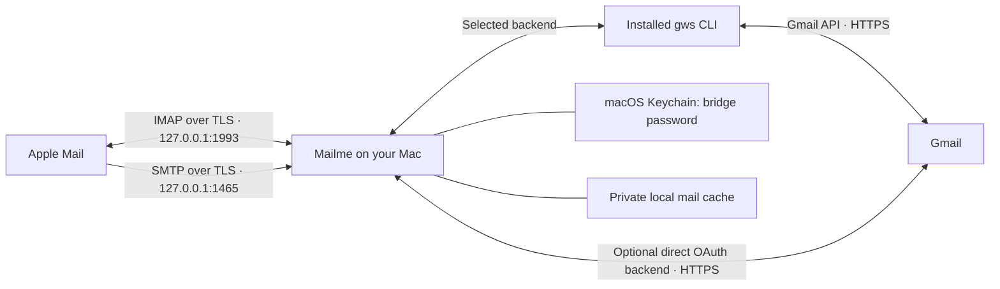

# Mailme

A local Gmail API bridge for Apple Mail, written in Go. Apple Mail talks IMAP and SMTP **only to your Mac**. Mailme talks to Google through the installed Google Workspace CLI (`gws`), or directly with Desktop OAuth, using the Gmail REST API over HTTPS. It never connects to Google's IMAP or SMTP servers.

This is an implementation for one account. The first live Workspace run exposed slow backfill, lost progress, and an intermittent HTTP 400. The recovery and concurrency changes below have been tested with a simulated CLI and fake Gmail service, including process-kill recovery. They have **not yet been validated on that live mailbox**.



SMTP handles sending; IMAP is also needed to read mail, discover folders, and synchronize changes. The organization must permit the local bridge and authorize its OAuth app. This does not override Google Workspace API access controls.

## What works

- An installed, authenticated `gws` CLI can provide all Gmail access using its existing credentials and token refresh. No additional OAuth app is needed in this mode. The local bridge password is stored separately in macOS Keychain.
- Optional direct Desktop OAuth with PKCE, state validation, and an ephemeral loopback callback; this backend also stores its Google tokens in macOS Keychain.
- Authenticated IMAP and SMTP over TLS, bound to numeric loopback addresses only. A unique localhost certificate is generated at login.
- Inbox, Sent, All Mail, Trash, Junk, Starred, and custom Gmail labels. User labels appear beneath `Labels/`.
- MIME message bodies, attachments, partial IMAP fetches, envelope/body structure, and searches including decoded text.
- Read/unread and starred flags synchronized to Gmail. Replied and pending-deletion flags are kept locally.
- Persistent per-folder UIDs and UIDVALIDITY, updates across simultaneous connections, and IMAP IDLE notifications after polling Gmail.
- Immediate TLS/IMAP/SMTP service using cached or partial mail. A fresh Inbox can initially be empty; new messages appear through EXISTS/IDLE as backfill commits.
- INBOX-first metadata backfill with six readers by default, durable batch checkpoints, and resume after a process crash. History-based sync follows every 30 seconds. Failed attempts keep completed batches without advancing the history cursor.
- Shared body downloads for simultaneous requests for the same message, cached envelope headers, and header searches that avoid downloading bodies when possible.
- SMTP envelope recipients mapped to Gmail's header-based recipient model, including Bcc. MIME bodies are preserved.

## Build and connect with gws

Requires macOS, Go 1.24 or later, access to your login Keychain, and an installed [Google Workspace CLI](https://github.com/googleworkspace/cli). This setup assumes `gws` is already authenticated for your work account using your organization's approved app.

```sh
go build -o bin/mailme ./cmd/mailme
./bin/mailme login --backend gws --email you@company.com
./bin/mailme settings --copy-password
./bin/mailme serve
```

`login --backend gws` checks your Gmail profile through the CLI, saves the selected backend and absolute executable path, and creates the local bridge password and TLS identity. It does not install `gws`, open an OAuth consent page, export CLI tokens, or send email. To select a particular installation, add `--gws-path /absolute/path/to/gws` to `login`. An npm `@googleworkspace/cli` Node shim is resolved to its installed native `bin/gws`, so launchd does not need nvm's `node` on PATH. An unresolved Node shim produces an actionable error. `serve` uses the saved backend; it does not fall back to direct OAuth.

The CLI's existing authorization needs `https://www.googleapis.com/auth/gmail.modify` (or equivalent Gmail permissions for all operations), covering reading, sending, changing labels, and Trash. Approval of the app alone does not grant these permissions. The login profile check verifies the account and read access; it does **not** exercise sending or modification permissions. Resolve missing access through your organization's approved `gws` authentication process. Mailme does not change CLI credentials or request new CLI scopes. See [Google's scope reference](https://developers.google.com/workspace/gmail/api/auth/scopes).

Every CLI request specifies your configured email as `userId`, so changing the CLI's active account causes requests to fail rather than silently switching mailboxes. Mailme inherits the CLI's normal environment and credential configuration. Run the bridge as the same macOS user that authenticated `gws`.

For an expired/revoked CLI token or HTTP 401, run:

```sh
gws auth login
```

Use the same account and grant Gmail modify access through your approved app. Mailme reports: `gws credentials expired or lack Gmail access; run gws auth login and grant Gmail modify`. A running bridge keeps serving cached mail and retries synchronization in-process after authorization is repaired. No Mailme re-login or cache deletion is needed to repair the CLI's credentials.

## Alternative: direct Desktop OAuth

Use your organization's approved Google Cloud project and OAuth client:

1. Enable the Gmail API in the project.
2. Configure the Google Auth Platform consent screen/audience as appropriate for your Workspace organization.
3. Create an OAuth client of type **Desktop app** and download its JSON credentials. Web-client credentials are rejected.
4. Request `https://www.googleapis.com/auth/gmail.modify`. It covers reading, sending, labels, and moving messages to Trash, without permanent message deletion. It is a restricted scope, so Workspace administrators may need to approve this client ID. See [Google's scope reference](https://developers.google.com/workspace/gmail/api/auth/scopes) and [Workspace app access controls](https://support.google.com/a/answer/7281227).

Keep the downloaded credentials outside the repository. Desktop OAuth uses a loopback redirect supported by [Google's native app flow](https://developers.google.com/identity/protocols/oauth2/native-app).

```sh
./bin/mailme login --backend oauth --credentials /absolute/path/client.json --email you@company.com
./bin/mailme settings --copy-password
./bin/mailme serve
```

OAuth login opens Google's consent page and checks that the authorized account matches `--email`. It does not send email. `--backend oauth` is the default when omitted, so existing login commands and saved configurations continue working.

To switch an existing account to `gws`, stop the bridge, run `login --backend gws --email ...` with the same data directory, then restart. This retains the mail cache, TLS identity, and local password. Old direct OAuth tokens remain in Keychain but are unused by the `gws` backend.

## Run the bridge

`settings --copy-password` sends the local bridge password to `pbcopy` and prints only a confirmation. Plain `settings` still prints the password for manual use; do not pipe that output to logs or share it. Your Google password is never given to the bridge or Apple Mail.

The default data directory on macOS is `~/Library/Application Support/mailme`. To change it, pass the same `--data-dir /absolute/path` to every command. Custom ports are configured with `serve --imap 127.0.0.1:1993 --smtp 127.0.0.1:1465`; pass those flags to `settings` as well to display them. Only one process may open a data directory.

Keep `serve` running while using Mail. TLS handshakes, authentication, and the cached/partial mailbox view are available immediately, even when Google is offline. Startup no longer binds sockets and waits for synchronization before serving them. Metadata listing and backfill run in the background; message bodies are downloaded and cached on demand. Apple Mail may fetch many of them immediately.

Use `serve --read-concurrency 6` to set 1–16 metadata workers. For `gws`, the same limit covers all read subprocesses, including foreground body downloads. All requests share quota pacing; writes remain serialized. Counts, rate, ETA, and skipped count are logged at the start, roughly every 30 seconds during fetching, and at completion. Skipped message IDs and sanitized errors are logged without headers or content.

`serve`, `probe`, and `install-agent` default to `--quota-profile current`: 80 quota units/s with the newer method costs. The LaunchAgent saves that choice in its arguments. `--quota-profile legacy` uses 125 units/s and the older costs; use it only after verifying that the approved Google Cloud project retains both the legacy costs and limits. Increasing worker count cannot bypass the selected quota budget.

The first profile history ID is saved as a **pending cursor before listing**. INBOX IDs are ordered first, then the remainder of the mailbox is backfilled. The first small batch becomes visible promptly; subsequent checkpoints occur every 250 messages or 30 seconds. A restart validates the pending cursor and resumes unfinished IDs, preserving published UIDs/UIDVALIDITY. A hard kill can require refetching the current uncommitted batch, not the completed batches. Only a finished snapshot promotes the pending cursor to the normal history checkpoint. Subsequent history sync catches changes made during and between attempts. If the pending history has expired, a new full snapshot starts while cached mail remains visible.

Metadata reads with HTTP 400 `invalidArgument`/`failedPrecondition`, HTTP 404, or malformed message responses are recorded and retried on subsequent syncs. A 404 also removes a previously cached message. Unclassified HTTP 400s, authorization/permission errors, CLI execution failures, and cancellations stop the attempt without discarding committed batches. Background retries back off from 2 to 60 seconds. This matters for an intermittent 400 that succeeds on a later attempt: it no longer forces a complete restart.

### Large-mailbox timing

The reported live baseline was about **2.7 messages/s** at 0.36–0.39 s per CLI call: about **103 minutes** for 16,650 metadata reads. Bypassing the npm shim alone did not materially improve that reported latency.

A local, hermetic benchmark with 60 simulated CLI calls and **370 ms latency per call** measured:

| Quota profile | Read workers | Elapsed for 60 reads | Rate | Projection for 16,650 reads |
| --- | --- | --- | --- | --- |
| Legacy | 1 | 23.652 s | 2.54 messages/s | 1 h 49 min 23 s |
| Legacy | 6 | 4.145 s | 14.47 messages/s | 19 min 10 s |
| **Current (default)** | **6** | **15.144 s** | **3.96 messages/s** | **1 h 10 min 3 s** |

The conservative default deliberately caps sustained metadata reads near four per second. Budget **at least 70 minutes** for 16,650 messages with this profile, plus listing, retries, checkpoints, and foreground body downloads; Inbox becomes usable during backfill. Six legacy workers measured about **5.7×** the simulated single-worker rate, but that faster profile requires verified legacy quota eligibility. These are **synthetic results, not live Gmail measurements**. The projections include request pacing and simulated subprocess latency, but exclude listing and disk commits. Measure the actual installation with `probe` below.

A separate 16,650-message fake backfill, with projected headers and real bbolt checkpoints but zero API latency, completed in **3.345 seconds**. This measures local indexing overhead only, not end-to-end Gmail sync. Body and attachment downloads consume more quota and may extend setup considerably.

Both backends request only `id,labelIds,internalDate,threadId,payload/headers` for metadata, with From, To, Cc, Bcc, Reply-To, Sender, Subject, Date, Message-ID, In-Reply-To, and References. Envelope and supported header/date searches can use this cache. Arbitrary `HEADER` queries, `TEXT`, `BODY`, exact size filters, and MIME structure requests fall back to full MIME, so reducing the metadata projection does not change search semantics. Actual response-size savings need measurement against the live mailbox.

## Configure Apple Mail

First trust the generated `localhost.crt` from the data directory using **Keychain Access**: import it into your login keychain, open the certificate, and explicitly trust it for SSL. This certificate is used only for the local connection. Mailme does not install trust settings automatically. Do not import or share `localhost.key`.

Alternatively, the exact command for the default directory is:

```sh
security add-trusted-cert -r trustRoot -p ssl \
  -k ~/Library/Keychains/login.keychain-db \
  "$HOME/Library/Application Support/mailme/localhost.crt"
```

Add **Other Mail Account**, using the work email and the local bridge password. Select **IMAP**. Use these server settings:

| Setting | Incoming | Outgoing |
| --- | --- | --- |
| Host | `127.0.0.1` | `127.0.0.1` |
| Port | `1993` | `1465` |
| TLS/SSL | Enabled, implicit TLS | Enabled, implicit TLS |
| Authentication | Password | Password |
| Username | Full work email | Full work email |
| Password | Local bridge password | Local bridge password |

Disable **Automatically manage connection settings** so Mail uses these ports. The initial account wizard may fail while trying standard ports; finish manual configuration in Mail's account settings. Exact screens differ by macOS version. Refer to [Apple's server settings guide](https://support.apple.com/guide/mail/change-server-settings-cpmlprefacctadv/mac).

In **Mail → Settings → Accounts → Mailbox Behaviors**, configure:

| Mailbox behavior | Selection |
| --- | --- |
| Drafts | An **On My Mac** mailbox |
| Sent | An **On My Mac** mailbox |
| Trash | `Gmail/Trash` |
| Junk | `Gmail/Junk` |
| Archive | `Gmail/All Mail` |
| Erase deleted messages | **Never**; empty Trash through Gmail |

Local Drafts and Sent are required because IMAP APPEND is not implemented. Gmail already saves messages submitted via the API in its Sent mailbox, which appears as `Gmail/Sent`. Mail's local Sent copy is separate and may also appear in its unified Sent view. Drafts remain on this Mac. Apple documents these mailbox choices in [Mailbox Behaviors](https://support.apple.com/guide/mail/change-mailbox-behaviors-settings-cpmlprefacctmbox/mac).

## Message operations

| Action | Gmail result |
| --- | --- |
| Read / unread | Remove / add `UNREAD` |
| Star / unstar | Add / remove `STARRED` |
| Copy into a user-label folder | Add that label to the same Gmail message |
| Move from Inbox to a user-label folder | Add destination label, then remove `INBOX` |
| Archive from Inbox | Remove `INBOX` |
| Move to Trash | Gmail `messages.trash` |
| Move from Trash to Inbox | Untrash, then add `INBOX` |
| Expunge a deleted message from Inbox or a user-label folder | Remove that source label |
| Expunge from Starred | Remove `STARRED` |
| Expunge from All Mail, Sent, or Junk | Move to Trash |
| Expunge from Trash | Rejected; no permanent deletion endpoint exists in this bridge |

Gmail labels are views of the same message, so an IMAP copy does not duplicate the underlying message. `\Deleted` is staged per folder and persisted until expunge; it is not immediately a Gmail deletion. Cross-folder moves use the client's COPY + STORE + EXPUNGE sequence. There is no IMAP MOVE extension yet.

## Storage and operational details

- `config.json`: account, selected backend, and either the absolute `gws` path or Desktop OAuth client configuration, mode `0600`. Missing `backend` means `oauth` for compatibility.
- `mail.db`: bbolt database with metadata, persistent UIDs, local flags, subscriptions, downloaded MIME bodies, pending backfill IDs/completed batches, and skipped IDs/errors, mode `0600`.
- `localhost.crt` / `localhost.key`: local TLS identity, valid for one year. To renew, stop the bridge, move both files aside, rerun login, and trust the new certificate.
- Keychain service `mailme.gmail-api-bridge`: `<email>:bridge`, plus `<email>:oauth` when direct OAuth has been used. `gws` owns its own Google credential storage.
- With `gws`, outgoing MIME is passed through `--upload` as a `0600` file inside a temporary `0700` directory. It is removed on success, failure, and cancellation. An abrupt process kill or machine crash can leave this temporary data behind. Message bodies are never passed in CLI arguments.

The cache is **not encrypted by the application**. Protect it using the Mac's normal disk encryption and access controls, and treat backups as mail data. The program does not log message bodies, passwords, or OAuth tokens. Raw protocol tracing is disabled. Deleting the cache changes IMAP identities and causes Mail to resynchronize; stop the bridge before manipulating it.

Google's May 2026 quota model allows 6,000 units per user per project per minute. Mailme's default `current` profile uses 80 units/s (4,800/minute), with costs of 20 for metadata reads, 60 for raw/full body reads, 20 for Trash, and 100 for sends. All foreground and background requests share that budget. Other applications using the same account/project can consume the remaining headroom. Google says qualifying older projects retain their previously set quotas; Mailme does not assume that exemption. See [Gmail quota costs and eligibility](https://developers.google.com/workspace/gmail/api/reference/quota).

Reads retry 429, 5xx, and 403 `rateLimitExceeded`/`userRateLimitExceeded` with backoff. Direct HTTP honors `Retry-After`, including HTTP dates, capped at 60 seconds. The CLI backend honors a structured `retryAfter` when provided; gws 0.22.5 discards HTTP headers, so it uses backoff when that information is absent. See [Gmail error guidance](https://developers.google.com/workspace/gmail/api/guides/handle-errors).

Mailme never automatically retries a write or reinvokes a failed send, including after a 401. If a send fails after Google may have accepted it, Mail receives an error asking you to check Gmail Sent before retrying. Exactly-once delivery cannot be guaranteed across an interrupted API response or a disconnected local SMTP client.

The `gws` backend uses raw Discovery commands (`gmail users getProfile`, `labels list`, `messages list/get/modify/trash/untrash/send`, and `history list`) with `--params` and `--format json`. Sending requires `--upload` and `--upload-content-type message/rfc822`. Mailme manages pagination without the CLI's `--page-all` page limit. Commands have a one-minute deadline and bounded output; stderr stays discarded. Errors contain HTTP code, method, message ID, and sanitized machine status/reasons when present. They never include Google's free-form error message. gws 0.22.5 preserves only one flattened reason and omits `error.status` and additional reasons; Mailme cannot recover fields the CLI has discarded. See the [0.22.5 executor](https://github.com/googleworkspace/cli/blob/v0.22.5/crates/google-workspace-cli/src/executor.rs).

gws 0.22.5 [reads cached tokens and refreshes when needed](https://github.com/googleworkspace/cli/blob/v0.22.5/crates/google-workspace-cli/src/auth.rs); its [encrypted cache uses atomic writes and an in-process mutex](https://github.com/googleworkspace/cli/blob/v0.22.5/crates/google-workspace-cli/src/token_storage.rs). Mailme runs one profile probe before fanning out reads. On simultaneous 401s, it drains active calls, runs one shared recovery probe, and retries only reads once if that probe succeeds. A persistent 401 requires `gws auth login`; Mailme does not force refresh, export tokens, inspect encrypted credentials, or coordinate other independently running gws processes. The proxy authentication path differs upstream; use `--read-concurrency 1` to diagnose environment-specific behavior.

State locks protect snapshots and short commits only; no Gmail or client response I/O runs under the global state lock. Complete local mutation commands remain ordered by a separate mutex. Per-message versions prevent an overlapping metadata read from overwriting a committed mutation; those IDs are reconciled again later. Search uses a command snapshot, and pending mailbox updates preserve client sequence-number mapping. Mutation responses never advance the history cursor. New UIDs append as batches arrive, so backfilling an older message does not renumber existing mail.

If Google blocks authorization, use the organization's app approval process. If refresh authorization expires or is revoked, reauthenticate `gws` for the CLI backend, or rerun Mailme's OAuth `login` for the direct backend. External apps left in Google's Testing state can have short-lived refresh tokens; see [Google's token expiration rules](https://developers.google.com/identity/protocols/oauth2#expiration).

## Current limits

- One account per process/data directory. Sending aliases, delegation, contacts, and calendars are not implemented.
- Draft synchronization, IMAP APPEND/import, folder creation/rename/deletion, permanent deletion, custom keywords, QRESYNC/CONDSTORE, and UIDPLUS are not implemented. Manage labels in Gmail.
- No offline write queue. Cached mail remains usable during sync failures; uncached bodies and writes require Google access. Fresh caches may initially show empty or partial folders.
- A simple in-memory metadata index is persisted transactionally. Each checkpoint rewrites that index; very large mailboxes can still spend time in local commits. Long commands no longer block other sessions on network I/O, but each IMAP connection processes its own command stream in order.
- Gmail changes appear on the polling interval, plus API processing time. No Cloud Pub/Sub setup is required.
- The `gws` backend still starts one subprocess per request. New arrivals outside the initial listing are caught by history sync after backfill finishes. Persistently skipped IDs are retried each sync, which can add load if there are many of them.
- The IMAP dependency is pinned to a v2 beta. Automated protocol coverage does not establish full Apple Mail compatibility; finish the manual checklist below before relying on this for daily work.

## Validation

```sh
go test -race ./...
go vet ./...
go build -o bin/mailme ./cmd/mailme
```

Tests use synthetic messages, a simulated CLI, a mock Keychain, and temporary local TLS/HTTP listeners. They do not require `gws`, access real Keychain secrets, authenticate to Google, send real email, change certificate trust, or run the LaunchAgent installer. In addition to protocol/MIME/OAuth coverage, they exercise a real SIGKILL and checkpoint resume, pending cursor expiry/promotion, skipped-ID retries, stable late-arrival UIDs, immediate partial mailbox access, nonblocking SELECT/NOOP during sync/FETCH/SEARCH/mutations, stale-read protection, body single-flight, 403 retries, bounded CLI concurrency, one 401 recovery probe, and clipboard-only password display.

Reproduce the synthetic throughput and 16,650-message index/persistence checks (no real account):

```sh
MAILME_BENCHMARK=1 go test ./internal/gws -run '^TestSimulatedThroughput$' -v -count=1
MAILME_BENCHMARK=1 go test ./internal/bridge -run '^TestLargeMailboxBackfill$' -v -count=1
```

### Read-only live diagnosis

The reported HTTP 400 succeeded on retry. Its original reason/status and failing ID are unavailable, so **the root cause remains unknown**; it is not evidence of a permanently malformed message. `probe` now records the safe details needed to distinguish those cases, without printing message content or the local bridge password:

```sh
./bin/mailme probe --start 0 --count 100 --read-concurrency 1
./bin/mailme probe --start 0 --count 100 --read-concurrency 6
./bin/mailme probe --message-id MESSAGE_ID
```

`probe` uses only profile, message-list, and metadata-get requests. Its indices use lexically sorted IDs to reproduce the old sync order. It does not open the cache or fetch raw MIME, and reports read rate separately from listing time. Probe timing includes subprocess overhead and retries; repeated runs can differ with network/cache conditions.

For a full live recovery check, stop any existing bridge first, run `serve`, verify TLS/login and progress, terminate that test process mid-backfill, then restart and inspect the resumed fetched count and stable UIDs. Do not delete or move the existing data directory to create a fresh run without its owner's approval. This task's unavailable remote Mac prevented that live check; all writes remain tested with fake Gmail only.

For the first live setup, verify:

1. Inbox and existing custom labels appear; an attachment opens correctly.
2. Read/unread and stars reflect in both Gmail and Mail.
3. New mail appears while Mail is idle, and restart does not duplicate messages.
4. Archive and Trash behave as expected, and moving a message out of Trash restores it.
5. A deliberate test email to yourself, with a second address in Bcc, arrives correctly. Confirm one server-side Sent copy and correct reply threading.
6. Drafts save locally, and Mail does not try to APPEND to the bridge's Sent folder.

For background use, after login and certificate trust:

```sh
./bin/mailme install-agent --read-concurrency 6 --quota-profile current
./bin/mailme uninstall-agent
```

`install-agent` writes `~/Library/LaunchAgents/com.mailme.bridge.plist` with the current executable and data directory's absolute paths, creates `~/Library/Logs/mailme/bridge.log`, and runs `launchctl bootstrap gui/$UID`. It unloads an existing service with that label before loading the new definition. `uninstall-agent` unloads the service and removes only its plist; mail data and credentials remain. Run these as your logged-in user, without `sudo`. Install from the binary location you intend to keep. The tests only render/parse the plist; they never install or load a service.

`contrib/com.mailme.bridge.plist.example` remains available for manual setup. For `gws`, login saves the native executable path, and startup also resolves older saved npm shims. A moved nvm/CLI installation requires rerunning `login --backend gws --gws-path ...`. The installer does not copy shell environment variables or credentials into the plist. If your CLI uses a custom config directory or other authentication environment, configure the necessary `EnvironmentVariables` manually; an interactive shell's environment is not inherited by launchd. Reinstalling replaces the plist, including manual edits.

The API synchronization and send semantics follow [Google's synchronization guide](https://developers.google.com/workspace/gmail/api/guides/sync) and [messages.send reference](https://developers.google.com/workspace/gmail/api/reference/rest/v1/users.messages/send).

## License

MIT. Copyright (c) 2026 Aditya Walvekar. See [LICENSE](LICENSE).
